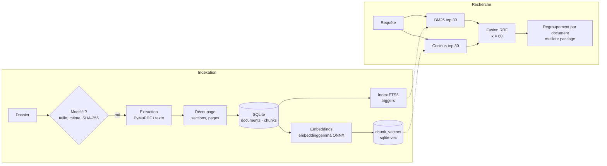

# Second Brain

**Recherche sémantique locale et privée dans tes propres documents.** *English version: [README.md](README.md).*

> Tu te souviens de l'idée. Ton ordinateur se souvient où elle se trouve.

Au lieu de chercher `rapport_final_v2.pdf`, tu demandes :
*« retrouve le document où j'avais comparé PostgreSQL et MongoDB »*, et tu obtiens le bon fichier et le bon passage en une seconde. Tout tourne sur ta machine : aucun document ne la quitte.


## Pourquoi ce projet

La recherche du bureau trouve des noms de fichiers et des mots exacts. Or on se souvient d'idées, de reformulations, parfois dans une autre langue. Second Brain combine les deux approches :

- **Recherche lexicale (BM25)** : imbattable sur les termes exacts, les codes et les noms (`API-472`, `IATF 16949`).
- **Recherche sémantique (embeddings multilingues)** : trouve *« numérisation des archives municipales »* quand on tape *« copies informatiques des vieux dossiers communaux »*, en français, en anglais et en allemand.
- **Fusion hybride (RRF)** : combine les deux classements sans comparer des scores incomparables.

C'est un projet d'apprentissage et de portfolio (phase 1), construit pas à pas. Chaque décision de recherche est **mesurée, pas supposée**, et consignée dans un [ADR](docs/adr/) (Architecture Decision Record).

## Fonctionnalités (V0)

- Indexation d'un dossier local : **PDF, Markdown, TXT**. Les PDF scannés sont détectés et signalés.
- **Indexation incrémentale** : fichiers nouveaux, modifiés, supprimés ou inchangés ; une transaction par document.
- **Découpage selon la structure** : sections Markdown et pages PDF, puis paragraphes et phrases.
- Trois modes de recherche, `lexical`, `semantic` et `hybrid` (par défaut). Les résultats sont regroupés par document, avec leur provenance (`BM25 #3 · sens #1`).
- **Banc d'évaluation** avec des exécutions sauvegardées et reproductibles : Hit@k, Recall@k et MRR, par type de question et par langue.
- **100 % local** : un seul fichier SQLite (tables, FTS5 et vecteurs) et des modèles ONNX. Aucun accès réseau à l'exécution, hormis le premier téléchargement du modèle.

## Architecture



Chaque composant est derrière une interface (`DocumentExtractor`, `Chunker`, `Embedder`, `Retriever`). Ajouter un format de fichier, un modèle ou une méthode de recherche revient à écrire une nouvelle implémentation, sans modifier les autres.

```text
src/second_brain/
├── extraction/   fichier → ExtractedDocument (texte, pages, sections)
├── chunking/     ExtractedDocument → chunks (extraits exacts avec leur position)
├── embeddings/   textes → vecteurs normalisés (fastembed / ONNX)
├── indexing/     détection des changements + pipeline en deux phases (texte, puis vecteurs)
├── search/       lexical.py · semantic.py · fusion.py · hybrid.py · grouping.py
├── storage/      accès SQLite, migrations numérotées
└── cli.py        CLI Typer, sans logique métier
eval/             questions.yaml · métriques · run_eval.py · results/
```

## Choix techniques

| Domaine | Choix | Pourquoi | ADR |
|---|---|---|---|
| Langage, interface | Python 3.12, CLI d'abord | Itérer vite sur la qualité de recherche avant toute interface | [0001](docs/adr/0001-python-et-cli-d-abord.md) |
| Stockage | **Un seul fichier SQLite** pour les tables, le plein texte et les vecteurs | Pas de désynchronisation entre deux bases ; facile à distribuer | [0002](docs/adr/0002-sqlite-base-unique.md) |
| Recherche | Hybride BM25 + vecteurs, **Reciprocal Rank Fusion** | Fondée sur les rangs : les scores BM25 et cosinus ne sont pas comparables | [0003](docs/adr/0003-recherche-hybride-rrf.md), [0010](docs/adr/0010-parametres-de-fusion.md) |
| Embeddings | Modèles multilingues via **ONNX** (fastembed), sans PyTorch | Corpus français et anglais ; installation légère | [0004](docs/adr/0004-embeddings-onnx-multilingues.md) |
| Modèle | **google/embeddinggemma-300m**, préféré à e5-large et potion après mesure | Meilleure qualité sémantique sur les deux jeux de test | [0009](docs/adr/0009-modele-embeddings-et-stockage-vectoriel.md) |
| Évaluation | Dès la V0, arbitre de chaque décision de recherche | Mesurer, pas supposer | [0005](docs/adr/0005-evaluation-des-la-v0.md) |
| Confidentialité | Local par défaut ; jamais de contenu de document dans les logs ni les erreurs | C'est *ta* mémoire | [0006](docs/adr/0006-local-first-et-confidentialite.md) |
| Extraction PDF | PyMuPDF | Qualité et vitesse mesurées (licence AGPL à revoir avant distribution) | [0007](docs/adr/0007-bibliotheque-pdf.md) |
| Accès aux données | SQL brut avec `sqlite3` | FTS5 et sqlite-vec sont le cœur du projet ; aucun ORM ne les prend en charge | [0008](docs/adr/0008-sql-brut-sqlite3.md) |

## Résultats d'évaluation

Deux jeux de test :
- **`samples`** : 6 PDF inventés et 11 questions écrites pour piéger BM25 (synonymes, autre langue, singulier/pluriel, césure).
- **EDiTh / Véracier Industries** : un benchmark public de 1 004 PDF d'entreprise et 40 questions pleines de codes et de noms propres.

On demande 10 documents par question. Les documents sans couche de texte (scans) sont exclus.

| Méthode | samples Hit@1 | samples MRR | EDiTh Hit@1 | EDiTh MRR |
|---|---|---|---|---|
| BM25 | 0,55 | 0,64 | **0,62** | **0,67** |
| Sémantique (embeddinggemma) | 0,64 | 0,82 | 0,40 | 0,48 |
| **Hybride RRF (par défaut)** | **0,73** | **0,86** | 0,45 | 0,57 |

Ce que ces chiffres montrent, honnêtement :

- Sur les questions naturelles, reformulées ou dans une autre langue, **l'hybride gagne nettement** (+0,22 de MRR face à BM25), sans jamais perdre une question face à BM25.
- Sur les demandes métier pleines de codes, **BM25 seul reste devant**. `--mode lexical` reste disponible pour ces cas.
- 18 variantes de fusion ont été testées : k = 20, 60 et 100, pondérations, fusion par document. Les écarts restent dans le bruit : on a donc gardé le RRF standard plutôt que de l'ajuster sur 40 questions ([ADR 0010](docs/adr/0010-parametres-de-fusion.md)).

Les exécutions brutes, avec la configuration complète et le commit git, sont dans [`eval/results/`](eval/results/).

## Installation

Prérequis : Linux ou macOS, [uv](https://docs.astral.sh/uv/), et Python 3.12 avec le chargement d'extensions SQLite activé. C'est le cas par défaut sous Linux et avec les Python gérés par uv.

```bash
git clone git@github.com:HamzaMF7/second-brain-.git
cd second-brain-
uv sync

uv run second-brain index ~/Documents/notes      # le premier lancement télécharge le modèle (~1,2 Go)
uv run second-brain search "comparaison PostgreSQL MongoDB"
uv run second-brain search "API-472" --mode lexical   # instantané, sans charger de modèle
```

Autres commandes : `extract <fichier>` pour voir le texte extrait, `chunks <fichier>` pour voir le découpage, et `--help` sur chaque commande.

Pour le développement :

```bash
uv run pytest                                   # 360 tests, sans vrai modèle
uv run ruff check . && uv run mypy              # lint + typage strict
uv run python eval/run_eval.py --set samples --db <base>   # évaluer
```

## Limites connues

- **Pas encore d'OCR** : les PDF scannés sont détectés et listés, mais pas cherchables (prévu en V1).
- **La première indexation est lente sur CPU** : environ 1 s par chunk avec embeddinggemma, soit à peu près 2 h pour 1 000 PDF. Les passages suivants ne calculent que les nouveaux chunks.
- **Chaque `search` charge le modèle**, ce qui prend environ 2,5 s. Une API qui tourne en continu le gardera en mémoire (V1).
- **L'hybride renvoie toujours des résultats**, même pour une question sans réponse : il n'y a pas encore de seuil de pertinence.
- **Les jeux d'évaluation sont petits** (11 + 40 questions) et ne viennent pas des documents de l'utilisateur : les résultats montrent des tendances, pas des preuves.
- La licence n'est pas encore choisie : PyMuPDF (AGPL) et les conditions d'utilisation de Gemma sont à revoir avant toute distribution.

## Prochaines étapes

| Version | Contenu |
|---|---|
| **V1** | **OCR** des PDF scannés, nouveaux formats (**DOCX, Excel, HTML**), surveillance des fichiers, filtres (dossier, type, date), API FastAPI locale et interface simple |
| **V2** | **Reranker** (cross-encodeur) si la mesure le justifie, RAG avec citations via Ollama |
| Produit | Application desktop Tauri, packaging, sécurité de l'API locale, chiffrement au repos |

## Documentation

- [Document de conception](docs/conception.md) : vision long terme et architecture cible
- [Architecture Decision Records](docs/adr/)
- [Journal de bord](docs/journal.md)
