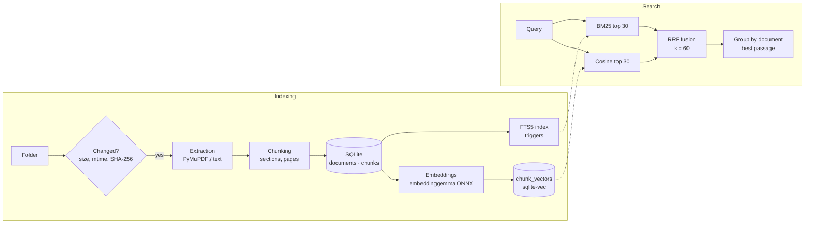

# Second Brain

**Local, private semantic search over your own documents.** *Version française : [README.fr.md](README.fr.md).*

> You remember the idea. Your computer remembers where it is.

Instead of hunting for `rapport_final_v2.pdf`, you ask:
*"find the document where I compared PostgreSQL and MongoDB"* — and get the right file, the right passage, in a second. Everything runs on your machine: no document ever leaves it.


## Why this project

Desktop search finds file names and exact words. People remember ideas, paraphrases, and sometimes the wrong language. Second Brain combines both worlds:

- **Lexical search (BM25)** — unbeatable on exact terms, codes, names (`API-472`, `IATF 16949`).
- **Semantic search (multilingual embeddings)** — finds *"digitising old municipal records"* when you type *"computer copies of old town files"*, across French, English and German.
- **Hybrid fusion (RRF)** — merges both rankings without comparing incomparable scores.

It is a learning and portfolio project (phase 1), built step by step with every search decision **measured, not assumed**, and recorded in an [Architecture Decision Record](docs/adr/).

## Features (V0)

- Indexes a local folder: **PDF, Markdown, TXT**; scanned PDFs are detected and reported.
- **Incremental indexing**: new / modified / deleted / unchanged files; one transaction per document.
- **Structure-aware chunking**: Markdown sections and PDF pages, then paragraphs and sentences.
- Three search modes: `lexical`, `semantic`, `hybrid` (default), results grouped by document with provenance (`BM25 #3 · sens #1`).
- **Evaluation harness** with saved, reproducible runs (Hit@k, Recall@k, MRR, per question type and language).
- **100 % local**: one SQLite file (tables + FTS5 + vectors), ONNX models, no network at runtime except the first model download.

## Architecture



Every component sits behind an interface (`DocumentExtractor`, `Chunker`, `Embedder`, `Retriever`): adding a file format, a model or a search method means adding an implementation, not editing the others.

```text
src/second_brain/
├── extraction/   file → ExtractedDocument (text, pages, sections)
├── chunking/     ExtractedDocument → chunks (exact excerpts with offsets)
├── embeddings/   texts → normalised vectors (fastembed / ONNX)
├── indexing/     change detection + two-phase pipeline (text, then vectors)
├── search/       lexical.py · semantic.py · fusion.py · hybrid.py · grouping.py
├── storage/      SQLite access, numbered migrations
└── cli.py        Typer CLI, no business logic
eval/             questions.yaml · metrics · run_eval.py · results/
```

## Technical choices

| Topic | Choice | Why | ADR |
|---|---|---|---|
| Language, interface | Python 3.12, CLI first | Fast iteration on search quality before any UI | [0001](docs/adr/0001-python-et-cli-d-abord.md) |
| Storage | **A single SQLite file** for tables, full-text and vectors | No desynchronisation between two databases; easy to ship | [0002](docs/adr/0002-sqlite-base-unique.md) |
| Search | Hybrid BM25 + vectors, **Reciprocal Rank Fusion** | Rank-based: BM25 and cosine scores are not comparable | [0003](docs/adr/0003-recherche-hybride-rrf.md), [0010](docs/adr/0010-parametres-de-fusion.md) |
| Embeddings | Multilingual models via **ONNX** (fastembed), no PyTorch | French + English corpus; light install | [0004](docs/adr/0004-embeddings-onnx-multilingues.md) |
| Model | **google/embeddinggemma-300m**, chosen over e5-large and potion after measurement | Best semantic quality on both test sets | [0009](docs/adr/0009-modele-embeddings-et-stockage-vectoriel.md) |
| Evaluation | From V0, arbitrates every search decision | Measure, don't assume | [0005](docs/adr/0005-evaluation-des-la-v0.md) |
| Privacy | Local by default; no document content in logs or errors | It is *your* memory | [0006](docs/adr/0006-local-first-et-confidentialite.md) |
| PDF extraction | PyMuPDF | Measured quality and speed (AGPL to review before distribution) | [0007](docs/adr/0007-bibliotheque-pdf.md) |
| Data access | Raw SQL with `sqlite3` | FTS5 and sqlite-vec are the core; an ORM supports neither | [0008](docs/adr/0008-sql-brut-sqlite3.md) |

ADRs and design docs are written in French.

## Evaluation results

Two test sets: **`samples`** — 6 invented PDFs, 11 questions written to trap BM25 (synonyms, other language, singular/plural, hyphenation) — and **EDiTh / Véracier Industries**, a public benchmark of 1,004 business PDFs with 40 questions full of codes and proper names. 10 documents per question; documents with no text layer (scans) excluded.

| Method | samples Hit@1 | samples MRR | EDiTh Hit@1 | EDiTh MRR |
|---|---|---|---|---|
| BM25 | 0.55 | 0.64 | **0.62** | **0.67** |
| Semantic (embeddinggemma) | 0.64 | 0.82 | 0.40 | 0.48 |
| **Hybrid RRF (default)** | **0.73** | **0.86** | 0.45 | 0.57 |

What it shows, honestly:

- On natural, paraphrased or cross-language questions, **hybrid wins clearly** (+0.22 MRR over BM25) and never loses a question to BM25.
- On code-heavy business requests, **BM25 alone stays ahead**; `--mode lexical` remains available.
- 18 fusion variants were tested (k = 20/60/100, weights, document-level fusion): differences stay within noise, so the standard RRF was kept rather than tuned on 40 questions ([ADR 0010](docs/adr/0010-parametres-de-fusion.md)).

Raw runs, with full configuration and git commit: [`eval/results/`](eval/results/).

## Installation

Requirements: Linux or macOS, [uv](https://docs.astral.sh/uv/), Python 3.12 with SQLite extension loading enabled (standard on Linux and on uv-managed Pythons).

```bash
git clone git@github.com:HamzaMF7/second-brain-.git
cd second-brain-
uv sync

uv run second-brain index ~/Documents/notes      # first run downloads the model (~1.2 GB)
uv run second-brain search "comparaison PostgreSQL MongoDB"
uv run second-brain search "API-472" --mode lexical   # instant, no model loaded
```

Other commands: `extract <file>` (inspect extracted text), `chunks <file>` (inspect chunking), `--help` on any command. The CLI speaks French.

Development:

```bash
uv run pytest                                   # 360 tests, no real model needed
uv run ruff check . && uv run mypy              # lint + strict typing
uv run python eval/run_eval.py --set samples --db <db>   # evaluate
```

## Known limitations

- **No OCR yet**: scanned PDFs are detected and listed, not searchable (planned for V1).
- **First indexing is slow on CPU**: about 1 s per chunk with embeddinggemma (≈ 2 h for 1,000 PDFs); later runs only embed new chunks.
- **Each `search` loads the model** (~2.5 s); a long-running API will keep it in memory (V1).
- **Hybrid always returns results**, even for questions with no answer: there is no relevance threshold yet.
- **Evaluation sets are small** (11 + 40 questions) and not written from the user's own documents: results show trends, not proof.
- Licensing not settled yet: PyMuPDF (AGPL) and the Gemma terms must be reviewed before any distribution.

## Next steps

| Version | Content |
|---|---|
| **V1** | **OCR** for scanned PDFs, new formats (**DOCX, Excel, HTML**), file watcher, filters (folder, type, date), local FastAPI + simple UI |
| **V2** | Cross-encoder **reranker** if measured useful, RAG with citations via Ollama |
| Product | Tauri desktop app, packaging, local API security, encryption at rest |

## Documentation

- [Design document](docs/conception.md) (French) — long-term vision and target architecture
- [Architecture Decision Records](docs/adr/) (French)
- [Development journal](docs/journal.md) (French)
